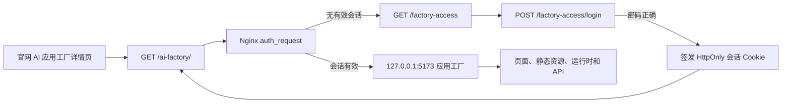

# 官网至 AI 应用工厂密码网关设计

## 背景与现状

官网是部署在 `https://www.tjgtkj.cn` 的 Astro 静态站点，生产 `current` 经只读核查指向 `releases/033e158`。官网的 AI 应用工厂详情页已经存在，但“前去体验”按钮仍为禁用状态。

应用工厂容器 `guangtai-ai-platform` 已在同一台服务器运行并保持健康，容器端口 `5173` 当前映射到 `0.0.0.0:5173`。外层 Nginx 尚未为应用工厂配置正式入口，直接访问 5173 可以取得应用页面和业务 API。服务器上的应用工厂代码主要对应本地仓库基线 `18ff1bb`，没有本地较新分支中的 PostgreSQL、对象存储和可信代理认证升级。

本次只打通官网至现有应用工厂的受保护入口，不顺带升级应用工厂业务版本或迁移生产数据。

## 目标

1. 官网“前去体验”变为可用入口，指向同域路径 `/ai-factory/`。
2. 未建立会话的访问者先看到仅包含密码字段的服务端登录页。
3. 密码验证成功后进入现有应用工厂，页面、静态资源、运行时页面和业务 API 使用同一会话。
4. 关闭从公网直接访问 5173 的绕过路径。
5. 密码不进入官网前端、应用源码、Git 历史、构建产物或日志。
6. 官网既有页面、百度验证路径、HTTP 到 HTTPS 跳转、404 和静态缓存行为保持不变。
7. 发布过程包含可验证的修改产物、补丁、验证记录和可执行回滚。

## 非目标

- 不新增独立子域名、DNS 记录或证书。
- 不部署本地较新的 PostgreSQL、MinIO、附件和租户认证版本。
- 不改变应用工厂的业务功能、模型供应商或现有持久化数据。
- 不把密码校验放在浏览器 JavaScript 中。
- 不复用官网静态站点作为认证状态存储。

## 方案选择

### 采用：同域 Nginx `auth_request` 与独立密码网关

外层 Nginx 继续终止 TLS。一个只监听回环地址的轻量 Node 网关负责登录页、密码验证、会话签名和会话检查。Nginx 使用已有的 `http_auth_request_module` 在代理应用工厂前检查会话。

该方案保持应用工厂业务容器不变，避免把一次入口接通扩展为数据库和对象存储迁移；同时可以在 Nginx 层覆盖页面、资源和 API，并将 5173 收口到回环地址。

### 未采用：独立子域名

独立子域名的路由边界更清晰，但当前没有对应 DNS 记录和证书，会引入额外的域名控制面与证书续期工作。

### 未采用：升级应用工厂并内置认证

本地新分支已经具有可信代理认证，但同时依赖 PostgreSQL、MinIO、迁移和新的运维契约。直接替换当前生产版本会显著扩大变更和数据风险。

## 架构

### 组件边界

#### 官网入口

- 将 `FactoryExperienceCta.astro` 的禁用按钮替换为正常链接。
- 链接使用同源绝对路径 `/ai-factory/`，不包含密码、令牌或查询参数。
- 更新静态渲染和 Playwright 合同，确认入口可访问且不再带有禁用属性。

#### 密码网关

- 使用独立目录和镜像构建，仅包含 Node 标准库实现，不增加运行时依赖。
- 提供以下端点：
  - `GET /healthz`：仅供本机容器健康检查。
  - `GET /login`：返回内联样式的密码表单，响应禁止缓存。
  - `POST /login`：验证密码，成功后签发会话并跳转。
  - `GET /check`：供 Nginx `auth_request` 校验会话，只返回 204 或 401。
  - `POST /logout`：清除会话 Cookie。
- 登录页只接受固定的站内返回路径 `/ai-factory/`，不接受任意外部跳转地址。

#### Nginx 路由

- `/ai-factory/` 经过 `auth_request` 后代理到 `127.0.0.1:5173/`。
- `/factory-access` 和登录、退出端点代理到回环地址上的密码网关。
- 应用工厂当前使用根绝对 URL。Nginx 为已核对的根级 JS、CSS、图片、运行时 HTML 和 `/api/` 建立受同一会话保护的精确或受限路由，不使用可吞并官网页面的宽泛通配规则。
- 应用容器和网关容器分别只绑定 `127.0.0.1:5173` 与 `127.0.0.1:5180`。
- Nginx 向上游传递 `Host`、真实客户端地址和 HTTPS 协议信息，不把浏览器提供的身份头直接转发为可信身份。

## 密码与会话安全

- 用户指定的密码只在生成加盐哈希时使用；生产 `.env` 保存哈希，不保存明文。
- 密码哈希使用 Node `scrypt`，每个部署值包含独立随机盐和明确参数版本。
- 密码比较使用恒定时间比较。
- 会话令牌包含版本、签发时间、过期时间和随机标识，并使用独立的 256 位随机密钥进行 HMAC-SHA256 签名。
- Cookie 使用 `HttpOnly`、`Secure`、`SameSite=Strict`、`Path=/` 和 8 小时最大有效期。
- 登录失败返回统一提示，不区分密码长度或局部匹配情况。
- 网关按来源地址执行有界的内存限速；达到阈值返回 429，并提供短期重试时间。
- 请求日志不记录密码、Cookie、会话签名、哈希或环境变量值。
- 网关只绑定回环地址；`X-Forwarded-For` 只从本机 Nginx 接收。

## 数据流与错误处理

1. 用户点击官网入口，请求 `/ai-factory/`。
2. Nginx 子请求 `/check`；没有有效 Cookie 时将浏览器跳转到 `/factory-access`。
3. 用户提交密码。格式无效、密码错误或限速分别产生可读提示，但均不回显输入。
4. 验证成功后返回 303，设置签名 Cookie，并跳转到 `/ai-factory/`。
5. 后续页面、模块、运行时页面和 API 请求都先经过相同会话检查。
6. 网关异常时采用失败关闭：应用工厂不透传，官网其余页面仍由静态站点提供。
7. 应用工厂异常时保留认证会话但返回 502；错误页不暴露上游地址或环境配置。

## 预期文件范围

### 官网仓库

- 修改 `src/components/pages/FactoryExperienceCta.astro`
- 修改 `tests/rendered-site.test.ts`
- 修改 `tests/browser/site-smoke.spec.ts`
- 更新 `说明文档.md`

### 应用工厂仓库或独立部署覆盖层

- 新增 `gateway/server.mjs`
- 新增 `gateway/lib/access-session.mjs`
- 新增 `gateway/tests/access-session.test.mjs`
- 新增 `gateway/Dockerfile`
- 修改 `compose.production.yml`，增加网关并收口端口绑定
- 修改 `.env.example`，仅增加变量名和生成说明
- 新增 `deploy/nginx/factory-access.conf` 模板
- 更新应用工厂 `说明文档.md` 与部署说明

### 发布产物

- 原始文件及 SHA-256 清单
- 官网和网关修改后的发布包
- 精确补丁或统一 diff
- 包含命令、输入、逐字输出和退出码的验证记录
- 可执行且已完成只读就绪检查的回滚脚本

## 测试设计

### 网关单元与集成测试

- 正确密码签发有效 Cookie。
- 错误、空白和超长密码被拒绝。
- 篡改、过期、缺字段和错误版本 Cookie 被拒绝。
- Cookie 属性包含 `HttpOnly`、`Secure`、`SameSite=Strict` 和限定寿命。
- 登录返回地址固定为站内应用路径，外部跳转输入被忽略。
- 连续失败触发 429，限速窗口结束后恢复。
- 日志捕获不包含测试密码、Cookie 或哈希。

### 官网测试

- 静态输出包含指向 `/ai-factory/` 的“前去体验”链接。
- 入口不包含 `disabled` 或 `aria-disabled="true"`。
- 桌面和手机浏览器测试确认入口可聚焦、可点击。

### 容器与 Nginx 合同

- Compose 展开后，5173 和 5180 都只绑定 `127.0.0.1`。
- 网关健康检查通过；应用工厂既有健康状态保持正常。
- `nginx -t` 通过后才允许热加载。
- 未登录访问应用页面、根级资源和 API 均被拦截。
- 正确登录后应用首页、资源、API、运行时页面和移动页面返回预期状态。
- 官网首页、AI 应用工厂介绍页、百度验证文件和未知路径保持既有状态。

## 发布顺序

1. 从远程生产目录制作只读源码快照和 SHA-256 清单，在本地副本上应用网关覆盖层。
2. 完成本地网关测试、官网验证、Compose 展开验证和隔离 Nginx 合同验证。
3. 生成修改产物、补丁、验证记录和回滚脚本，并重新打开执行各角色的就绪检查。
4. 经用户确认后，在远程服务器备份应用 Compose、`.env` 键结构和 Nginx 配置；不复制或输出现有秘密值。
5. 经用户确认后，上传网关文件和新官网 release，但不切换流量。
6. 经用户确认后，启动回环网关、收口应用端口，执行本机健康检查。
7. 经用户确认后，安装 Nginx include、执行 `nginx -t` 并热加载。
8. 经用户确认后，原子切换官网 `current`，执行公网未登录、错误登录、正确登录、应用功能和官网回归验证。

## 回滚设计

- 官网通过把 `current` 原子切回发布前 release 回滚。
- Nginx 通过恢复带 SHA-256 记录的原配置、执行 `nginx -t` 和热加载回滚。
- 应用 Compose 通过恢复原文件并重新创建原容器回滚；原数据卷不删除。
- 网关容器和文件只在确认旧路由恢复后停止；回滚不改写应用工厂数据。
- 回滚后验证官网路由、404、百度验证文件、应用容器健康及端口状态，并把结果写入同一验证记录。

## 验收标准

- 官网入口可用，且密码输入发生在服务端页面。
- 未登录和错误密码不能取得应用页面、资源或 API。
- 正确密码建立 8 小时会话并可使用现有应用工厂主要流程。
- 公网不再监听 5173 或网关端口。
- 密码明文没有出现在源码、Git、构建产物、日志和最终报告中。
- 官网既有生产行为无回归。
- 修改产物、补丁、验证记录和回滚脚本四类文件均可重新打开并验证。
